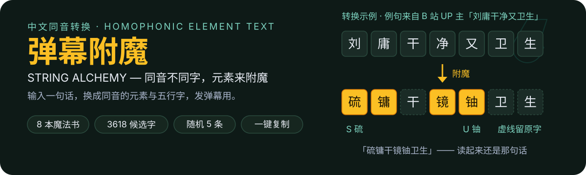
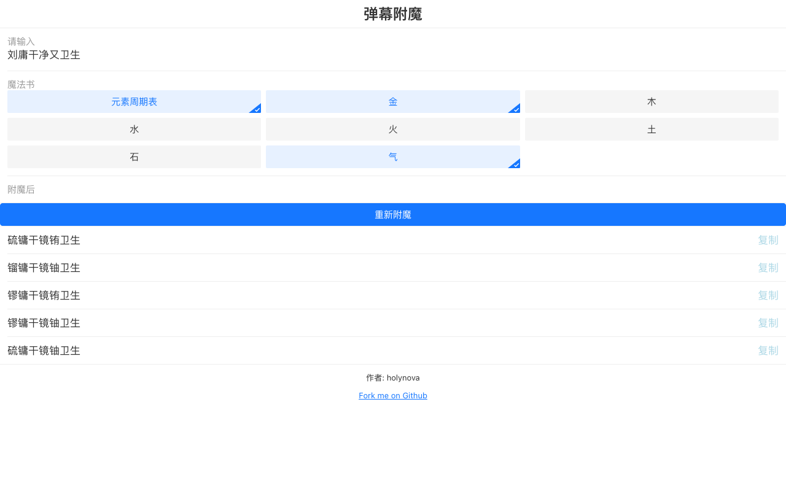

<p align="right"><a href="README.md">中文</a></p>

<p align="center">
  
</p>

<p align="center">
  <a href="https://xiaosang.cc/string-alchemy/">▶ Play Online</a>
  ·
  <a href="https://github.com/holynova/string_alchemy">GitHub Repository</a>
</p>

String Alchemy turns Chinese text into homophonic chemical-element characters: each character is replaced by an element name or a five-element radical character with the same pronunciation. It still reads like the same sentence — it just looks like pure chemistry. Inspired by Bilibili creator 刘庸干净又卫生 — the default example is his name, enchanted into 硫镛干镜铀卫生.

## Screenshot

<p align="center">
  
</p>

## How It Works

1. Type a sentence (the default is 「刘庸干净又卫生」).
2. Pick one or more 「魔法书」 ("spell books", i.e. dictionaries) — 元素周期表 (Periodic Table), 金 (Metal) and 气 (Air) are selected by default.
3. Tap 「重新附魔」 ("Re-enchant") to draw 5 random results from all combinations; tap any result to copy it.

Conversion rules (`src/pages/main.ts`): pinyin-pro gives each character's tone-numbered pinyin; same-tone homophones are preferred, falling back to other tones when none match; characters with no homophone in the dictionary stay unchanged (e.g. 「干」「卫」「生」). Selected dictionaries are merged, all per-character combinations are enumerated, and 5 are shown at random.

## Dictionaries

8 dictionaries, 2,109 pinyin keys and 3,618 candidate characters in total (counted from `src/common/dict/*.json`):

| Dictionary | Pinyin Keys | Candidate Characters |
|:---|---:|---:|
| 元素周期表 Periodic Table | 104 | 106 |
| 金 Metal | 216 | 241 |
| 木 Wood | 510 | 1,012 |
| 水 Water | 502 | 1,035 |
| 火 Fire | 240 | 406 |
| 土 Earth | 303 | 461 |
| 石 Stone | 210 | 325 |
| 气 Air | 24 | 32 |

Dictionaries are generated by `tools/makeDict.js` from `tools/raw.js` (`npm run makeDict`).

## Run Locally

```bash
git clone https://github.com/holynova/string_alchemy.git
cd string_alchemy
npm install
npm run dev      # dev server
npm run build    # tsc + vite build, output in dist/
```

The `docs/` folder in the repo holds a committed build output (used by GitHub Pages).

## Tech

- React 17 + TypeScript + Vite 2, UI with antd-mobile 5.
- Pinyin conversion: pinyin-pro (tone-numbered); copy: react-copy-to-clipboard.
- Dictionaries load on demand: `import.meta.glob` dynamically imports the selected JSON files, and `mergeAllDict` merges multiple dictionaries (candidates for the same pinyin are concatenated, not overwritten).

```
src/pages/HomePage.tsx   UI: input box, spell-book multi-select, results list, one-tap copy
src/pages/main.ts        Conversion core: pinyin dictionary lookup, cross-tone fallback, full permutation
src/common/dict/*.json   8 dictionaries (periodic table + metal, wood, water, fire, earth, stone, air)
tools/makeDict.js        Dictionary generation script
docs/                    Committed build output
```
