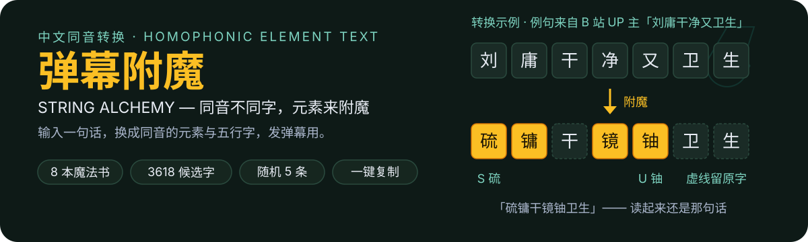
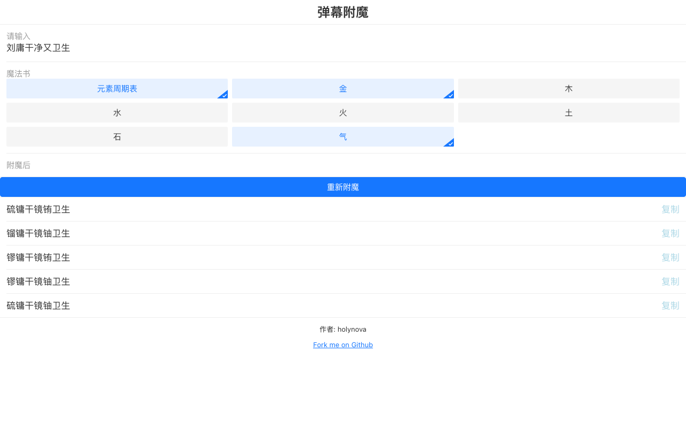

<p align="center">
  
</p>

<p align="center">
  <a href="https://xiaosang.cc/string-alchemy/">▶ 在线玩 Play Online</a>
  ·
  <a href="https://github.com/holynova/string_alchemy">GitHub 仓库</a>
</p>

弹幕附魔是一款中文同音转换小工具：输入一句话，把每个字换成同音的元素名或五行偏旁字，读起来还是那句话，看起来全是化学元素。灵感来自 B 站 UP 主「刘庸干净又卫生」——默认例句就是他的名字，附魔后变成「硫镛干镜铀卫生」。

String Alchemy turns Chinese text into homophonic chemical-element characters: each character is replaced by an element name or a five-element radical character with the same pronunciation. Inspired by Bilibili creator 刘庸干净又卫生 — the default example is his name, enchanted into 硫镛干镜铀卫生.

## 截图 / Screenshots

<p align="center">
  
</p>

## 怎么玩 / How It Works

1. 输入一句话（默认是「刘庸干净又卫生」）。
2. 选一本或多本「魔法书」（字典），默认选中元素周期表、金、气。
3. 点「重新附魔」，从全部组合里随机抽 5 条结果；点任意一条即可复制。

转换规则（`src/pages/main.ts`）：先用 pinyin-pro 取每个字的带调拼音，优先找同声调的同音字，找不到再跨声调找；字典里没有同音字时保留原字（比如「干」「卫」「生」）。多本字典合并后按字做全排列组合，再随机取 5 条展示。

## 魔法书 / Dictionaries

8 本字典，共 2109 个拼音键、3618 个候选字（`src/common/dict/*.json` 实数）：

| 字典 | 拼音键 | 候选字 |
|:---|---:|---:|
| 元素周期表 | 104 | 106 |
| 金 | 216 | 241 |
| 木 | 510 | 1012 |
| 水 | 502 | 1035 |
| 火 | 240 | 406 |
| 土 | 303 | 461 |
| 石 | 210 | 325 |
| 气 | 24 | 32 |

字典用 `tools/makeDict.js` 从 `tools/raw.js` 生成（`npm run makeDict`）。

## 本地运行 / Run Locally

```bash
git clone https://github.com/holynova/string_alchemy.git
cd string_alchemy
npm install
npm run dev      # 开发服务
npm run build    # tsc + vite build，产物在 dist/
```

仓库里的 `docs/` 是已提交的构建产物（GitHub Pages 用）。

## 技术 / Tech

- React 17 + TypeScript + Vite 2，界面用 antd-mobile 5。
- 拼音转换：pinyin-pro（带声调数字）；复制：react-copy-to-clipboard。
- 字典按需加载：`import.meta.glob` 动态 import 选中的 JSON，`mergeAllDict` 合并多字典（同拼音的候选字拼接而非覆盖）。

```
src/pages/HomePage.tsx   界面：输入框、魔法书多选、结果列表、一键复制
src/pages/main.ts        转换核心：拼音查字典、跨声调回退、全排列组合
src/common/dict/*.json   8 本字典（元素周期表 + 金木水火土石气）
tools/makeDict.js        字典生成脚本
docs/                    已提交的构建产物
```

## English

**String Alchemy** converts Chinese text into homophonic element characters — same pronunciation, all chemistry. Type a sentence, pick one or more "spell books" (dictionaries), and get 5 random enchanted variants; click any result to copy it.

- **8 dictionaries**: periodic table + metal, wood, water, fire, earth, stone, air — 2,109 pinyin keys, 3,618 candidate characters in total.
- **Matching**: pinyin-pro gives tone-numbered pinyin per character; same-tone homophones first, then other tones; characters with no homophone stay unchanged.
- **Example**: 刘庸干净又卫生 → 硫镛干镜铀卫生 (S 硫, U 铀; 干/卫/生 have no homophone in the selected books).
- **Tech**: React 17 + TypeScript + Vite 2, antd-mobile 5, pinyin-pro. Dictionaries load on demand via `import.meta.glob`.
